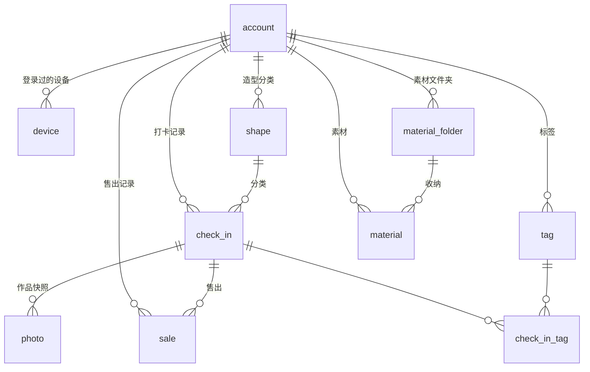

# 捏土打卡 · 数据库脚本

按 [PRD](../001/捏土打卡小程序-PRD.md) §6 数据模型设计，结合 [001](../001/) 的实际实现（`utils/db.js`）设计的云端数据库。

小程序当前是**本地优先**架构：数据存在 wx Storage 里，这套库是**同步落地的服务端存储**——对应 PRD §5.6.2 的 `/api/sync/push`、`/api/sync/pull` 接口。

## 文件

| 文件 | 内容 |
| --- | --- |
| `001_schema.sql` | 建表 DDL（10 张表 + 约束 + 索引） |
| `002_seed_data.sql` | 初始数据：内置造型、内置标签、账号、设备 |
| `003_views.sql` | 统计视图，把 PRD §6.3 的口径固化成 SQL |
| `004_sync.sql` | 同步语句：推送合并、增量拉取、回收站清理 |

执行顺序：`001` → `002` → `003` → `004`（`004` 是给服务端代码参考的语句模板，不直接执行）。

### 执行方式

```bash
MYSQL="/d/Program Files/MySQL/MySQL Server 8.0/bin/mysql"

"$MYSQL" -u root -p < 001_schema.sql
"$MYSQL" -u root -p < 003_views.sql

# 002 是模板：先把占位符换成真实值
sed "s/REPLACE_WITH_OPENID/真实openid/g; s/REPLACE_WITH_DEVICE_ID/真实设备id/g" 002_seed_data.sql   | "$MYSQL" -u root -p
```

> **读取数据时也要带 `--default-character-set=utf8mb4`**，否则中文和 emoji 显示成乱码
> （`$MYSQL -u root -p --default-character-set=utf8mb4 -e "..."`）。
> 写入端的字符集脚本里已经用 `SET NAMES utf8mb4` 处理了，但读取端是另一个连接，得自己加。

### 已验证

三个脚本在 **MySQL 8.0.43** 上实际执行通过，并用 PRD §12 的 **AC-2 场景**验证了视图算得对不对：

| 校验项 | 期望 | 实测 |
| --- | --- | --- |
| `v_yearly_production` 2026 | 产量 7 · 记录 2 条 · 有记录 2 天 · 日均 3.5 | ✅ |
| `v_yearly_production` 2025 | 产量 1 | ✅ |
| `v_yearly_revenue` 2026 | 营收 30 · 售出 1 | ✅ |
| `v_yearly_overview` 2026 | 未售 6 · 均价 30 · oversold 0 | ✅ |
| `v_shape_distribution` | QQ人 5 / OB11娃头 2 / 正比 1 | ✅ |
| `v_monthly_production` | 2026-01 = 5，2026-03 = 2 | ✅ |
| `v_monthly_revenue` | 2026-05 = 30 | ✅ |
| `v_inventory` | QQ人 5/0/5 · OB11娃头 2/1/1 · 正比 1/0/1 | ✅ |

同步语句（`004_sync.sql`）的合并语义也实测过：

| 场景 | 期望 | 实测 |
| --- | --- | --- |
| 新记录插入 | count = 1 | ✅ |
| `updated_at` 更新的版本推送 | 覆盖，count = 9 | ✅ |
| `updated_at` 更旧的版本推送 | **不覆盖**，仍是 9 | ✅ |
| 售出记录重复推送（`INSERT IGNORE`） | 幂等，金额不变 | ✅ |

## 选型

**MySQL 8.0+ / InnoDB / utf8mb4**

- 小程序后端用 MySQL 最普遍，运维和迁移成本最低
- 需要 8.0.16+ 才有真正的 `CHECK` 约束（之前会被解析后忽略）
- `utf8mb4` 是必须的——表里有 emoji（🧸🙂✨）和中文，`utf8`（3 字节）存不下

## ER 图



## 表清单

| 表 | 说明 | 关键点 |
| --- | --- | --- |
| `account` | 微信账号 | `openid` 主键；注册是隐式的，首次登录建号 |
| `device` | 登录过的设备 | `last_sync_at` 是增量拉取的游标 |
| `shape` | 造型分类 | `slot` 色槽位；内置分类每个账号各存一份 |
| `tag` | 标签 | 内置标签同样按账号存 |
| `check_in` | 打卡记录 | `date` 是**产量**的统计归属键 |
| `check_in_tag` | 打卡×标签 | 多对多，客户端是 `tagIds` 数组 |
| `photo` | 打卡照片 | `sort=0` 是封面 |
| `sale` | 售出记录 | `sold_date` 是**营收**的统计归属键；追加型不同步覆盖 |
| `material_folder` | 素材文件夹 | 删除不删素材 |
| `material` | 素材 | `folder_id IS NULL` = 未分类 |

## 字段对照（001 的 camelCase ↔ 数据库 snake_case）

同步层直接按这张表映射，不用在代码里做转换。

| 前端 `utils/db.js` | 数据库 | 说明 |
| --- | --- | --- |
| `checkIn.id` | `check_in.id` | 客户端生成，`ci_` 前缀 |
| `checkIn.date` | `check_in.date` | |
| `checkIn.shapeId` | `check_in.shape_id` | |
| `checkIn.count` | `check_in.count` | |
| `checkIn.note` | `check_in.note` | |
| `checkIn.durationMin` | `check_in.duration_min` | |
| `checkIn.tagIds` | `check_in_tag.tag_id` | **数组 → 多行** |
| `checkIn.createdAt` | `check_in.created_at` | |
| `checkIn.updatedAt` | `check_in.updated_at` | 冲突判定依据 |
| `checkIn.deletedAt` | `check_in.deleted_at` | `null` = 未删除 |
| `photo.localPath` | `photo.local_path` | 仅客户端有意义 |
| `sale.unitPrice` | `sale.unit_price` | |
| `sale.totalAmount` | `sale.total_amount` | 冗余存储 |
| `sale.soldDate` | `sale.sold_date` | |
| `shape.iconPath` | `shape.icon_path` | PRD 未提，实现里有 |
| `shape.slot` | `shape.slot` | PRD 未提，实现里有 |
| `material.folderId` | `material.folder_id` | `''` → `NULL`（未分类） |

## 关键设计决策

### 0. 所有时间列存的是 **UTC**

`created_at` / `updated_at` / `deleted_at` 一律存 **UTC**（`DATETIME(3)`，不带时区）。

服务端 JVM 的默认时区被固定成 UTC（`config/TimeZoneConfig.java`），客户端上传的也是
ISO-8601 UTC。两边统一 UTC，「后写覆盖先写」的同步判定才不会因为时差把新旧版本搞反。

**⚠️ 由此带来的坑：MySQL 服务端的 `NOW()` 返回的是服务器本地时间，和表里存的值差一个时差。**

```
SELECT NOW();          -- 本地时间，比如 20:11:22
SELECT UTC_TIMESTAMP(); -- UTC，比如 12:11:22   ← 和表里的值同一个基准
```

排查线上数据时请用 `UTC_TIMESTAMP()`，或者心里记得加/减时差。
按 `created_at DESC` 排序时，最新的记录**不一定**排在最前面——
如果你的服务器时区是 UTC+8，表里的 12:09 会排在本地时间 04:09 的记录前面。

### 1. `deleted_at` 取代 PRD 的 `status` 枚举

PRD §6.2 写的是 `status enum('normal','deleted')`。这里改成 `deleted_at DATETIME(3) NULL`，理由：

- 回收站要保留 **30 天**（PRD §5.1.3），必须知道「**什么时候**删的」才能做清理。`status` 枚举给不出时间，得再加一列。
- 口径完全等价：`status='normal'` ⟺ `deleted_at IS NULL`，统计视图里全部按 `deleted_at IS NULL` 过滤。

### 2. `check_in_tag` 拆出多对多

客户端把标签存成 `checkIn.tagIds` 数组（`utils/db.js`），但一个标签可以挂在多条记录上，数组表达不了关系。同步时展开成多行，服务端按关系表存。

### 3. 内置分类「每个账号各存一份」

`OB11娃头`、`QQ人`、`正比`、`其他` 是内置的，但用户可以**改名、改色、改默认单价、调整排序**（PRD §5.4.1）。所以它们不是全局字典表，而是每个账号各存一份、用 `is_builtin=1` 标记「不可删」。

好处：改分类名不需要动别人的数据，也不会因为内置分类变了要迁移历史数据。

### 4. 主键由客户端生成

同步场景下，客户端可能离线产生记录再上传。服务端如果自己生成主键，就得再维护一套「客户端临时 id ↔ 服务端 id」的映射表。

所以 `id` 用 `VARCHAR(64)`，客户端生成的 `ci_xxx` / `ph_xxx` / `mf_xxx` / `mt_xxx` 直接当主键。服务端只负责 upsert。

### 5. 售出记录是追加型

PRD §8.2：「售出记录为追加型不做覆盖」。因为 `total_amount` 已经被统计进报表，同一条售出记录被覆盖会改动历史统计结果。所以 `sale` 的推送用 `INSERT IGNORE`——同 id 重复推送幂等，但不会改动已入库的金额。

其余表用 `IF(VALUES(updated_at) > updated_at, ...)` 做字段级合并。

### 6. 软删除墓碑要同步

删除动作本身必须同步到云端（`deleted_at` 一起 push/pull），否则另一台设备会把已删的记录「复活」。

`003_views.sql` 的 `v_trash` 视图和 `004_sync.sql` 第 8 节的物理清理语句对应「我的 → 回收站」。

### 7. `slot` 色槽位

`utils/stat.js` 的 `shapeColor()` 按 `slot` 分配固定色，**筛选后不重新着色**。所以 `slot` 必须入库，否则换设备后分类颜色会变。

## 统计口径

PRD §6.3 的口径全部落成视图（`003_views.sql`），服务端接口和 BI 用同一份 SQL，不会各写一遍把规则写错：

| PRD 口径 | 视图 | 归属键 |
| --- | --- | --- |
| 累计产量 | `v_yearly_production` | `check_in.date` |
| 营收 | `v_yearly_revenue` | `sale.sold_date` |
| 未售出数量 | `v_yearly_overview.unsold` | 负数时置 0，`oversold=1` 标记 |
| 每日平均 | `v_yearly_production.avg_per_day` | 产量 ÷ **有记录的天数** |
| 造型分布 | `v_shape_distribution` | — |
| 按造型结缘金 | `v_shape_revenue` | — |
| 按渠道结缘金 | `v_channel_revenue` | — |
| 库存 | `v_inventory` | 累计口径，跨年结转 |
| 热力图逐日 | `v_daily_production` | — |

> **产量按打卡日、营收按售出日** —— 这两个归属键不同，是整个统计里最容易算错的地方。视图把它们拆开了，`v_yearly_overview` 才把它们并到一起。

## 踩过的坑（都是实跑时真报出来的）

### 1. 客户端连接字符集必须是 utf8mb4

不加 `--default-character-set=utf8mb4` 时，MySQL 客户端默认用较窄的字符集连接，
中文和 emoji 的**字节被当成字符数**来算，于是报一个完全看不懂的错：

```
ERROR 1406 (22001): Data too long for column 'name' at row 2
```

`name` 是 `VARCHAR(32)`，存的是「QQ人」3 个字，怎么就超了？

解决办法：脚本里加 `SET NAMES utf8mb4`（写入端），调用命令行加 `--default-character-set=utf8mb4`（读取端）。
三个脚本现在都自带 `SET NAMES utf8mb4`。

### 2. 渠道枚举必须和代码里的 id 一致

PRD §6.2 写的是 `xiaohongshu`，但 `001/utils/constants.js` 的 `CHANNELS` 里实际是 `xhs`：

```js
{ id: 'xhs', name: '小红书' }
```

数据库跟着 PRD 写会导致**每一次售出记录都插不进去**：

```
ERROR 1265 (01000): Data truncated for column 'channel' at row 1
```

数据库以**代码**为准（代码才是运行时写入的值），PRD 已同步改正。

### 3. `only_full_group_by` 下不能直接引用连接列

`v_inventory` 最初写成 `COALESCE(sl.sold, 0)`，在 MySQL 8 默认的
`only_full_group_by` 模式下直接报错：

```
ERROR 1055 (42000): Expression #4 of SELECT list is not in GROUP BY clause
```

改成 `SUM(COALESCE(sl.sold, 0))` 与 `SUM(c.count)` 相减——连接是「一条 check_in 对一条汇总」，
先聚合再相减，结果一样且能通过严格模式。

### 4. 复合外键不能用 `ON DELETE SET NULL`

`check_in.device_id` 的外键原本写的是 `ON DELETE SET NULL`，但复合外键里还带着 `openid`，
`SET NULL` 会把 `openid` 一起置空，而它是 `NOT NULL`：

```
ERROR 1830 (HY000): Column 'openid' cannot be NOT NULL: needed in a foreign key constraint
```

改成 `ON DELETE RESTRICT`——删设备本来也不该连带删掉打卡记录。

## 同步实现要点

见 `004_sync.sql`。三个容易写错的地方：

1. **`ON DUPLICATE KEY UPDATE` 里 `updated_at` 的赋值要放最后。** MySQL 按顺序赋值，如果先改了 `updated_at`，后面几列的 `IF(VALUES(updated_at) > updated_at, ...)` 就会拿新值跟新值比，永远成立。
2. **拉取要带上 `deleted_at`。** 只拉未删除的记录，删除动作就同步不过去了。
3. **`material.folder_id` 的空字符串要转 `NULL`。** `NULLIF(?,'')`，否则会撞外键约束。
